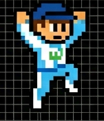
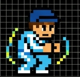
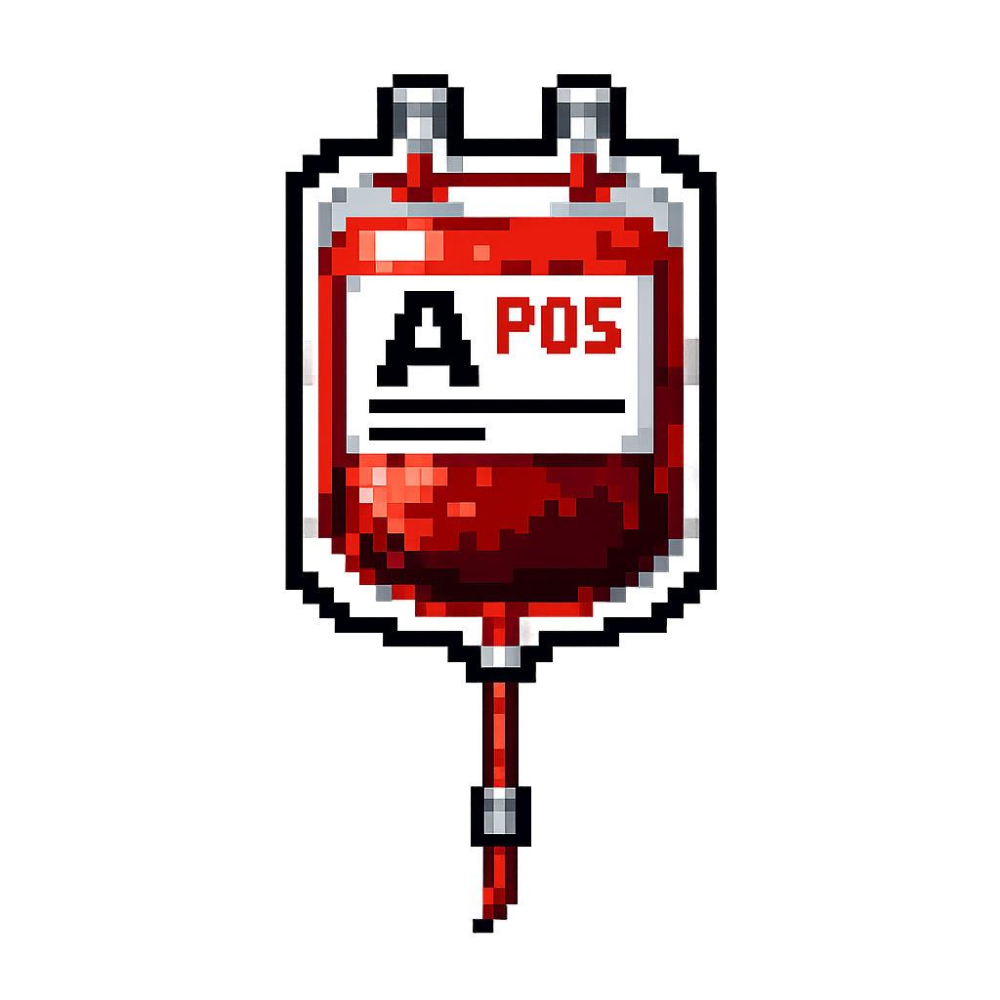
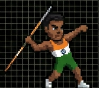
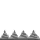
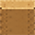

# Compete Clean – Game Design Document

## Vincent Ryan & Liam Davis

## Introduction

### Game Summary
Compete Clean is a 2D platformer where players take on the role of a World Anti-Doping Agency (WADA) agent tasked with collecting evidence across three increasingly difficult levels. Players must navigate obstacles, beat a time limit, and collect blood samples to build a case against a suspected athlete. The outcome depends on how much evidence is gathered, leading to either justice or failure.

### Inspiration
Doping in athletics has always been a problem. And while organizations like WADA exist in order to prevent cheating, the challenge of catching and successfully exposing such people is often much more complicated. We hope to bring light to the doping situation in sports while allowing the player to engage in an interesting and challenging mission as a WADA agent. 

For our art style we took some general inspiration from Kirby's Adventure which has a light, visually pleasing retro feel as it is a classic 8-bit game. We also drew from the Super Mario Bros 2 mechanic of the charge jump into our game, which allows the player to charge their jump for a limited amount of time in order to reach higher locations. 

---

## Technical Details
-
-
-
-

### Debug Mode
- Our debug mode shows lots of useful features like the player hitbox, javelin hitbox, spike hitbox, and stats like jump velocity, animation frame, and our grounded boolean. The most useful feature though is when in debug mode, if you click "N" you will skip whichever level you are on and bring you to the next one. 
## Art Details
- All of our textures for the player, enemy, items, and tiles were generated using Gemini, and then edited to fit what we wanted better. Here is an example prompt: 

- All of our screens (splash, instructions, win/lose/in between) were generated using ChatGPT. We did this by giving Chat our wada_spritesheet.png so it could use our general theme, and then a prompt along these lines: "Generate a splash screen for a 2d platformer called Compete Clean. Attatched is a sprite sheet of our main character and some other sprites, feel free to gain reference from them. Write "Press Space to Play" on the screen. The game is about catching an athlete who is doping and bringing justice to the sport, so the background should be something like a track arena."

## Concept

### Gameplay Overview
The player controls a WADA agent navigating through three levels, attempting to collect enough evidence.

### Theme Interpretation

#### Action Codes
The narrative unfolds through different gameplay actions, which serve as the primary storytelling device:
- Navigating hazards (javelin throwers, spike traps, sand pits)
- Performing precise and high jumps
- Trying to gather evidence
All of these actions help drive the story of the game on. 

Each obstacle represents resistance, not all realistic to the world, but still symbolic of the difficulty when uncovering truth in a system that is known to resist exposure. As the player progresses through levels, the intensity increases, creating narrative escalation.

#### Enigma Codes
The game begins with a question regarding the integrity of an athlete, the player is not explicitly told the person you're after is cheating, instead it is something you must uncover. This uncertainty frames some of the experience. There is a bit of mystery, and to solve it the player must collect evidence scattered across increasingly difficult levels. Each collected item gets you closer to answering the mystery, but never fully resolves it until the end. 

#### Look and Feel
Visually, Compete Clean uses a retro, pixel art style, forming a light and approachable tone, which we then contrast with the serious underlying theme of doping and corruption. The player should be visually pleased as they navigate levels and collect evidence, but have a sense of importance as their performance has an impact in serving justice.

---

## Credits/Reference
- Outside of any AI resources cited above in the art section, here are our sources:
-   Game Music (game_music.mp3): 8-bit-Fantasy. "8 Bit Fantasy Level 007." _8 Bit Fantasy Music_, Soundcloud, 2025, https://soundcloud.com/ravenala/8-bit-fantasy-level-007
-   Blood pickup sound (blood_pickup.mp3): danhelbling (Freesound), "Object Drops In Water." Pixabay, 2022, https://pixabay.com/sound-effects/film-special-effects-object-drops-in-water-84639/
-   Weight pickup sound (weight_sound.mp3): RossBell (Freesound), "Tea Cup Clank." Pixabay, 2022, https://pixabay.com/sound-effects/film-special-effects-tea-cup-clank-80001/
-   Heart image (heart.png): 6 Pixel Heart (PNG Transparent), https://www.onlygfx.com/6-pixel-heart-png-transparent/

## Mechanics

### Primary Mechanics
| Mechanic| Description | Image |
|---|---|---|
| Movement | The player can traverse the level by moving left and right. |  |
| Jump | By pressing space the player can jump over obstacles, or onto higher surfaces. |  |
| Charge Jump | By holding down the down key, the player can charge their jump to reach higher locations.  |  |
| Weights |  The player can pick up weight items which will increase their max Charge Jump ability. |  |
| Blood bags |  The player can pick up blood bags which is how you test the athlete at the end. The more collected the better chance of a succesful test. |  |

### Secondary Mechanics
| Mechanic| Description | Image |
|---|---|---|
| Javelin Thrower |  The player will have to avoid javelins being thrown in their direction as they complete the mission. |  |
| Spike | Some track spikes have been littered throughout the journey, avoid them to not take damage |  |
| Sand Trap |  Slows player movement and decreases jump height |  |
| Wind | There is a 1/5 chance of a windy day each level, which effects player movement. |  |
